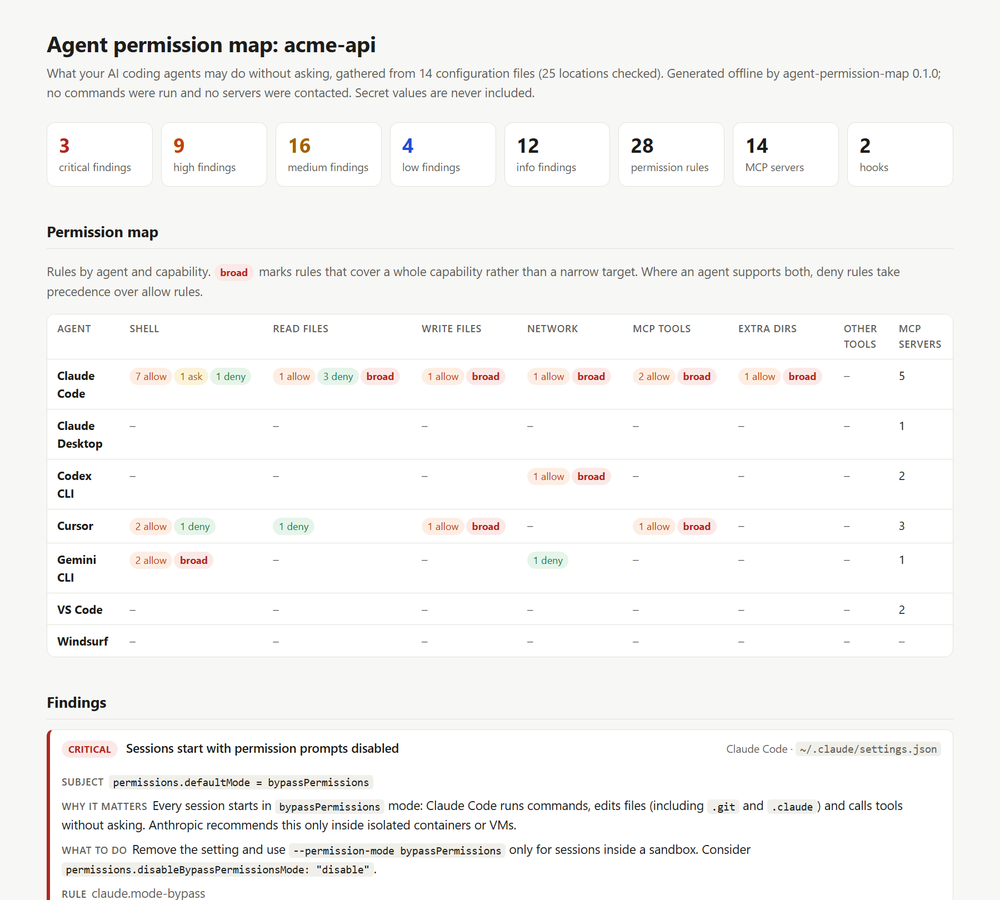

# agent-permission-map

**See what your AI coding agents may do without asking, across every tool you use, in one report.**

Claude Code, Codex, Cursor, Gemini CLI, VS Code and Claude Desktop each keep permission rules,
approval modes and MCP servers in their own files, in their own formats, at user, project and
local scope. A `Bash(python *)` allow rule in a committed `.claude/settings.json`, a Codex
profile with `danger-full-access`, an MCP server that `npx` downloads unpinned on every start:
each one is easy to miss on its own, and nobody reads all of them side by side.

`agent-permission-map` finds those files, normalizes them into one model, and explains each
risky setting in plain language: what it allows, why that matters, and what to change.
It runs locally, reads only, and never contacts a server.

<picture>
  <source media="(prefers-color-scheme: dark)" srcset="docs/images/report-preview-dark.png">
  
</picture>

<sub>The HTML report for the bundled demo fixtures, unedited. Open the full page from <a href="examples/demo-report.html">examples/demo-report.html</a> after cloning.</sub>

```text
$ agent-permission-map demo
Scanned 14 files for claude-code, claude-desktop, codex, cursor, gemini-cli, vscode, windsurf (25 locations checked).
28 permission rules, 14 MCP servers, 2 hooks.
Findings: 3 critical, 9 high, 16 medium, 4 low, 12 info

  [CRITICAL] No sandbox and no approvals
      sandbox_mode = danger-full-access, approval_policy = never (profile: yolo)  —  ~/.codex/config.toml
      Why: Codex runs every command with full filesystem and network access and never asks first. ...
  [HIGH] `python` may run with any arguments
      Bash(python *)  —  ./.claude/settings.json
      Why: `python` executes whatever code or command it is given, so allowing it with a wildcard is
           equivalent to allowing every shell command. Because this file is shared through the repository, ...
```

Full example outputs from the bundled fixtures: [text](examples/demo-report.txt) ·
[JSON](examples/demo-report.json) · [HTML](examples/demo-report.html) (download and open it locally).

## Safe to run on your own machine

This tool reads files that describe what other programs may do, and some of those files hold
credentials. It is built to be boring in that position:

- **Read-only.** Config files are opened for reading only. The only file it ever writes is the
  report you name with `--out`, and it refuses to overwrite an existing file unless you add `--force`.
- **Offline.** No network module is imported, and neither dependency uses one. MCP servers are
  never started or contacted, and no package registry is queried.
- **Nothing is executed.** Agent commands, hooks, credential helpers and server commands are
  reported as text, never run. No `child_process`.
- **Secrets stay out of reports.** `env` and header *values* are never copied, only their names.
  Credential-looking arguments, URL userinfo and query values are replaced with `[REDACTED]`.
  Env files (`envFile`) are listed but not opened. From `~/.claude.json` only MCP server entries
  are read; account details and other projects' entries are ignored.
- **Deterministic.** Same files in, byte-identical report out, on Linux, macOS and Windows.
  Reports contain no timestamps or hostnames, and files under your home directory or the project
  are shown as `~/...` and `./...`. Only files elsewhere, such as managed policy, keep an
  absolute path.

These properties are enforced by tests, not only promised. See [SECURITY.md](SECURITY.md).

## Quick start

Requires Node.js 22 or later. The package is not on npm yet. Run it straight from GitHub:

```sh
npx --yes github:jahau/agent-permission-map demo   # scan the bundled example fixtures
npx --yes github:jahau/agent-permission-map        # scan ~ and the current directory
```

npx downloads the repository and builds it once. The scan itself makes no network requests.
To work from a clone instead:

```sh
git clone https://github.com/jahau/agent-permission-map
cd agent-permission-map
npm ci                       # also builds dist/
npm run demo
node dist/bin.js --project ~/code/my-repo --format html --out report.html
```

Text output goes to the terminal. JSON and HTML are easiest to keep with `--out`, which
never replaces an existing file unless you add `--force`.

### Options

| Option | Effect |
| --- | --- |
| `--project <dir>` | Project to scan (default: current directory). `--no-project` skips project files. |
| `--home <dir>` | Home directory to scan (default: yours). Also ignores `CLAUDE_CONFIG_DIR`, `CODEX_HOME`, `APPDATA` and similar, for reproducible output. `--no-user` skips user files. |
| `--system` | Also read managed/system policy files for this OS (for example `/etc/claude-code/managed-settings.json`). |
| `--format text\|json\|html` | Terminal summary (default), machine-readable JSON, or a self-contained static HTML page. |
| `--out <file>` | Write the report to a new file. |
| `--fail-on <severity>` | Exit 1 if any finding is at or above `critical`, `high`, `medium`, `low` or `info`. |

Exit codes: `0` success, `1` findings at or above `--fail-on`, `2` usage or I/O error.

### In CI

Check the agent configuration committed to a repository, without reading anyone's home directory:

```yaml
- run: npx --yes github:jahau/agent-permission-map --no-user --fail-on high
```

## What it reads

| Agent | Files | What is analyzed |
| --- | --- | --- |
| Claude Code | `~/.claude/settings.json`, `.claude/settings.json`, `.claude/settings.local.json`, `.mcp.json`, `~/.claude.json`; managed `managed-settings.json` / `managed-mcp.json` with `--system` | `permissions.allow/ask/deny`, `defaultMode`, `additionalDirectories`, MCP approval keys, hooks, `env` names, credential helpers, sandbox, MCP servers (user, project and local scope) |
| Codex CLI | `~/.codex/config.toml`, `.codex/config.toml` | `approval_policy`, `sandbox_mode`, `sandbox_workspace_write`, profiles, `shell_environment_policy`, `[mcp_servers.*]` |
| Cursor | `~/.cursor/mcp.json`, `.cursor/mcp.json`, `~/.cursor/cli-config.json`, `.cursor/cli.json` | MCP servers; CLI `permissions` (`Shell`, `Read`, `Write`, `WebFetch`, `Mcp`) |
| Gemini CLI | `~/.gemini/settings.json`, `.gemini/settings.json`; system settings with `--system` | `tools.allowed/exclude/core/confirmationRequired`, `general.defaultApprovalMode`, `security.*`, `mcp.*`, `mcpServers` (including `trust`) |
| VS Code | `.vscode/mcp.json`, default-profile user `mcp.json` (stable and Insiders) | `servers`, `inputs` |
| Claude Desktop | `claude_desktop_config.json` | `mcpServers` |
| Windsurf | `~/.codeium/windsurf/mcp_config.json` | `mcpServers` |
| Copilot CLI | `~/.copilot/mcp-config.json` | `mcpServers` |

Exact paths per OS, the keys each parser reads, and the documentation they were checked against
are in [docs/supported-configs.md](docs/supported-configs.md).

## What it flags

Every finding carries a severity, the exact rule or setting it is about, the file it came from,
an explanation, and a fix. A sample:

| Severity | Example |
| --- | --- |
| critical | Claude Code `defaultMode: bypassPermissions` in user settings; Codex `danger-full-access` with `approval_policy = never`; a literal credential in a committed MCP config |
| high | `Bash`, `Bash(*)`, `run_shell_command`, or wildcards on interpreters (`python *`, `node *`, `docker *`); Gemini `trust: true`; plaintext `http://` remote MCP servers; containers with `--privileged` or `/` mounted; home directory as an extra working directory |
| medium | `curl *`, `npm run *`, `git *`; any-domain `WebFetch`; unscoped file writes; `enableAllProjectMcpServers`; hooks defined in shared project settings; MCP packages run through `npx`/`uvx` without a pinned version; `bash -c` server launchers |
| low / info | `acceptEdits` and `auto_edit` modes; whole-server MCP allow rules; remote MCP hosts that receive tool calls; env files the tool did not open; unreadable files |

The rule matcher understands each agent's syntax. `Bash(git diff *)` and `Bash(npm run test *)`
are not flagged. `Bash(git push *)` and `Bash(npm run *)` are. An unanchored `mcp__*` allow rule
is reported as *ignored*, because Claude Code ignores it. A project-level `bypassPermissions` is
rated lower than a user-level one, because current Claude Code versions ignore it there. All rules:
[docs/rules.md](docs/rules.md).

## The report model

`--format json` gives a stable, sorted document (`schemaVersion: 1`):

- `sources`: each file found, with agent, scope (`managed`, `system`, `user`, `project`, `local`), display path, parse status and warnings
- `permissions`: normalized rules: `effect` (`allow`/`ask`/`deny`), `capability` (`shell`, `file-read`, `file-write`, `network`, `mcp`, `directory`, `tool`), the original rule text, and `broad`
- `posture`: modes, sandbox, trust and approval settings
- `mcpServers`: transport, command and redacted arguments or URL, env and header *names*, enabled state, auto-approval
- `hooks`: event, matcher, redacted command
- `findings`: `ruleId`, `severity`, `subject`, `title`, `explanation`, `recommendation`

The HTML report draws the same data as a capability map per agent, followed by findings, servers,
rules and settings. It has no scripts, loads no external resources, and sets a
`default-src 'none'` Content-Security-Policy.

## How it compares

MCP-focused scanners already exist, and they go further than this tool on server analysis.
Some start servers to list their tools, check tool descriptions for prompt injection, or look up
packages in vulnerability databases. Examples include `mcp-scan`, `mcp-audit` and
`mcp-permission-audit`. Some of them do this over the network or by running server code.

`agent-permission-map` does something narrower, and it complements those tools:

- It maps the **agent's own permission system**, not only MCP servers: allow/ask/deny rules,
  approval and sandbox modes, extra directories, hooks and auto-approval switches.
- It covers several agents in **one normalized model**, so you can compare one agent's posture
  with another's.
- It has a strict **zero-network, zero-execution** contract you can verify in the test suite,
  which makes it practical in locked-down environments and CI.

It does not inspect what an MCP server does once it is running, and it does not judge whether
a pinned package version is itself safe.

## Limitations

- Only the locations listed above are checked. Project files are read from the project root.
  Nested monorepo packages, per-workspace VS Code settings, Codex project trust entries and
  plugin-provided servers are not covered yet.
- Formats change. Parsers ignore unknown keys and report wrong types as warnings instead of
  failing, but a newly added risky setting will not be flagged until a rule exists for it.
  Findings describe what a setting allows according to the vendor's documentation. They do not
  prove that the agent behaves that way in every version.
- Layering is not resolved. Each file is reported on its own, so a project rule that a managed
  policy overrides is still listed.
- Secret detection is heuristic. It errs toward redacting, and a final pass removes well-known
  token shapes from every string in the report. A credential with no recognizable name or
  shape, in a field the tool echoes, can still slip through. Review a report before sharing it.
- Rule text, server names, hostnames and env variable *names* are reported on purpose. They are
  the inventory. Treat reports from your own machine as internal documents.

## Development

```sh
npm ci
npm test            # type-checks, compiles and runs the node:test suite
npm run lint        # stricter compiler checks (unused code, missing returns, switch fallthrough)
npm run demo:write  # regenerate examples/ after an intended output change, then review the diff
npm run licenses    # offline dependency license check
```

Tests include schema fixtures for every format ([test/fixtures/schemas](test/fixtures/schemas)),
malformed-input cases (broken JSON and TOML, wrong types, BOMs, invalid UTF-8, oversized files,
directories in place of files), golden reports, and the safety checks described above. CI runs
on Linux, macOS and Windows with Node 22 and 24.

## License

[Apache-2.0](LICENSE). Dependency review: [docs/license-review.md](docs/license-review.md).
