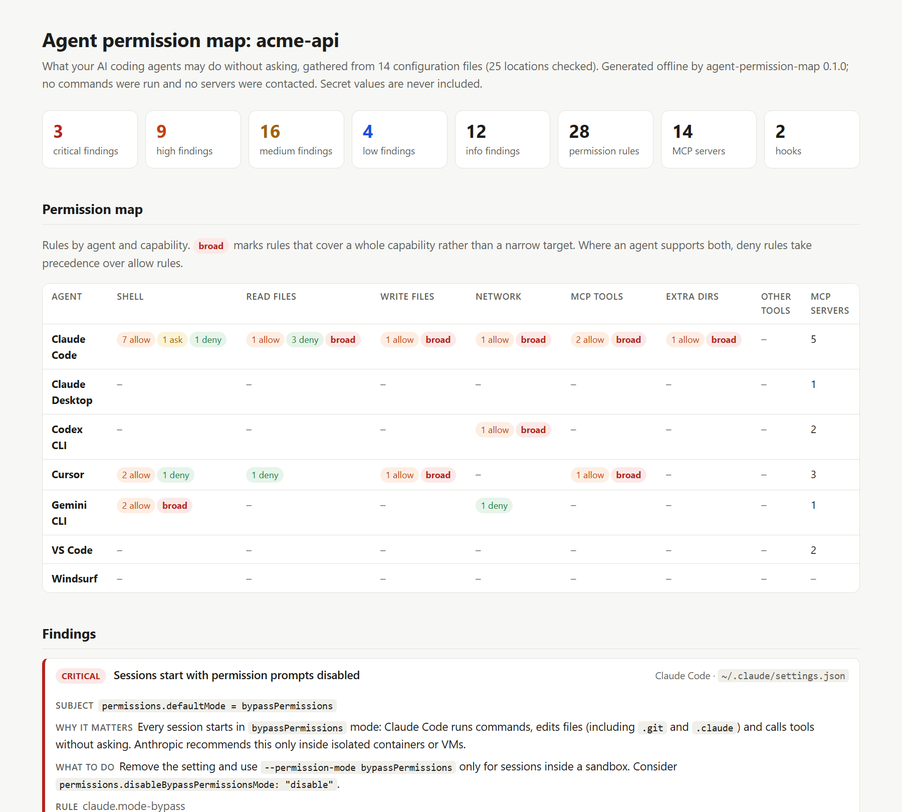

**See what your AI coding agents may do without asking, across every tool you use, in one report.**

Agent Permission Map is a local, read-only command-line tool. It finds the permission, approval
and MCP server configuration of your AI coding agents, puts it into one model, and explains each
risky setting: what it allows, why it matters, and what to change.



## Highlights

- **Eight agents, one model.** Claude Code, Codex CLI, Cursor, Gemini CLI, VS Code, Claude Desktop, Windsurf and Copilot CLI, at user, project and local scope. Managed and system policy files are read with `--system`.
- **Normalized permissions.** Allow, ask and deny rules by capability (shell, file read, file write, network, MCP, extra directories), plus approval and sandbox modes, MCP servers and hooks.
- **41 risk rules with explanations.** Each finding names the rule or setting, the file, why it matters and a fix. The rules know each agent's syntax: `Bash(git diff *)` is not flagged and `Bash(python *)` is. Severity accounts for whether a file is shared through the repository.
- **Three formats.** A terminal summary, JSON (`schemaVersion: 1`), and a single static HTML page with no scripts or external resources.
- **CI-friendly.** `--fail-on <severity>` sets the exit code. `--no-user` scans only what a repository commits.

## Safety properties

The test suite checks each of these:

- **Read-only.** Nothing is written except the report you name with `--out`, which never replaces an existing file without `--force`.
- **Offline.** There are no network modules in the code or its two dependencies, and a full scan passes with network and subprocess APIs disabled.
- **Nothing executed.** Hooks, credential helpers and MCP server commands are reported as text and never run.
- **Secrets redacted.** Env and header values are never copied. Credential-looking arguments, URL credentials and query values are redacted, and a final pass removes known token shapes from every string. Env files are not opened.
- **Deterministic.** The same input gives byte-identical reports on Linux, macOS and Windows.

## Install and run

Requires Node.js 22 or later. The package is not published to npm. Run it from GitHub:

```sh
npx --yes github:jahau/agent-permission-map#v0.1.0 demo   # bundled example fixtures
npx --yes github:jahau/agent-permission-map#v0.1.0        # your home directory and the current project
```

Or from a clone:

```sh
git clone --branch v0.1.0 https://github.com/jahau/agent-permission-map
cd agent-permission-map
npm ci
npm run demo
node dist/bin.js --format html --out report.html
```

## Examples

Generated from the bundled fixtures, unedited:
[text](https://github.com/jahau/agent-permission-map/blob/v0.1.0/examples/demo-report.txt) ·
[JSON](https://github.com/jahau/agent-permission-map/blob/v0.1.0/examples/demo-report.json) ·
[HTML](https://github.com/jahau/agent-permission-map/blob/v0.1.0/examples/demo-report.html) (download and open locally).

Reference: [supported files and keys](https://github.com/jahau/agent-permission-map/blob/v0.1.0/docs/supported-configs.md) ·
[all rules](https://github.com/jahau/agent-permission-map/blob/v0.1.0/docs/rules.md) ·
[security notes](https://github.com/jahau/agent-permission-map/blob/v0.1.0/SECURITY.md).

## Known limitations

- Only the documented locations are checked, and project files only at the project root. Nested monorepo packages, VS Code `settings.json` auto-approve settings, Codex project trust entries and plugin-provided MCP servers are not covered.
- Each file is reported on its own. Precedence between managed, user, project and local settings is not resolved.
- Formats were checked against vendor documentation on 2026-11-18. Unknown keys are ignored, so a newly introduced risky setting is not flagged until a rule exists. Windsurf support is best effort.
- Analysis is static. Runtime flags (for example `--yolo` or `--dangerously-skip-permissions`), server-delivered policy and the behavior of running MCP servers are out of scope.
- Secret detection is heuristic. Review reports before sharing them, because they list server names, hosts and commands by design.

## Feedback

This is the first public release. Bug reports, configuration examples from tools and versions
not covered yet, and corrections to the rules are welcome in
[issues](https://github.com/jahau/agent-permission-map/issues). Report vulnerabilities privately,
as described in [SECURITY.md](https://github.com/jahau/agent-permission-map/blob/v0.1.0/SECURITY.md).

Licensed under Apache-2.0.
